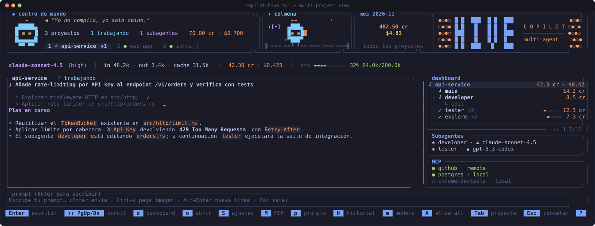

# Copilot Hive

A Rust terminal UI (TUI) for running **multiple GitHub Copilot CLI sessions in parallel** and monitoring their agents, subagents, permissions, and AI Credits usage in real time.

It connects to Copilot over **ACP** ([Agent Client Protocol](https://docs.github.com/en/copilot/reference/copilot-cli-reference/acp-server), `copilot --acp --stdio`) for interactive control and reads `~/.copilot/session-state/<sessionId>/events.jsonl` to build the subagent hierarchy and usage metrics.



## Key features

- **Multi-project tabs:** open multiple repositories at once (from config or with the folder picker `o`), each with its own ACP session, independent prompt draft, and status indicator.
- **Project groups:** tag projects with an optional `group` in the config; the header lists every group (project count, `●` working, red `!` pending permission) and shows only the current group's tabs. Switch group with `{` / `}`; `Tab` and `Alt+1..9` move within the group.
- **Multi-project sessions (`g`):** pick any set of open projects (or a whole group with `g` inside the picker) and start one session that can access all of them. Started sessions are remembered in `~/.config/copilot-hive/sessions.toml` and can be reopened after a restart (`Tab` inside the picker).
- **Real-time dashboard:** sidebar panel (`d`) and full view (`s`) showing running agents, grouped completed history, spend bars, assigned vs. actual models, and tool call activity.
- **Permissions & `/fleet`:** approve or deny requests (`y`/`n`/`a`), jump to the next blocked project with `!`, toggle *allow all* (`A`), or dispatch parallel subagents with `/fleet` (`f`).
- **Usage & monthly budget:** live AI Credits (and USD estimate) per agent, per session, and month-to-date across all projects in the header.
- **Reusable local prompts (`p` / `Ctrl+S`):** shared prompt library stored locally in `~/.config/copilot-hive/prompts.toml`.
- **Models, subagents & MCP control:** switch model (`m`) and reasoning effort (`e`), pin required subagent models (`🔒`), enable/disable MCP servers per project (`M`), and resume past sessions (`H`).
- **Mouse, themes & i18n:** independent pane focus and scrolling (`]`/`[` or mouse click/wheel), dark/light theme, and English/Spanish UI (`S`).


## Requirements

- **Rust** stable (2024 edition).
- **GitHub Copilot CLI** (`copilot`) installed and authenticated in your `PATH` with ACP support (`copilot --acp --stdio`).
- TrueColor-capable terminal (minimum `60×20`; sidebar appears at `100+` columns).

## Install & run

```bash
git clone https://github.com/EstebanSalmeron/CopilotHive.git
cd CopilotHive
cargo install --path .
```

Or run directly without installing:

```bash
cargo run --release -- tui
```

### Project configuration

By default it reads `~/.config/copilot-hive/projects.toml` (or `--config PATH`):

```toml
[[projects]]
name = "api-service"
path = "/path/to/api-service"

[[projects]]
name = "web-app"
path = "/path/to/web-app"
```

Add an optional `group` to organise many projects. Groups are ordered by first appearance; projects without a `group` form their own group, so existing configs behave as before:

```toml
[[projects]]
name = "bestone-bi4-sales-core-customerservice"
path = "/path/to/customerservice"
group = "Core"
```

If the file does not exist, Copilot Hive opens in the current working directory. See [`docs/config.example.toml`](docs/config.example.toml) for a template.

## Quick keybindings

| Key | Action |
|-----|--------|
| `Tab` / `Alt+1..9` | Switch project tab within the current group |
| `}` / `{` | Next / previous group |
| `g` | Multi-project session: `Space` pick (first = `cwd`), `g` whole group, `c` clear, `Enter` start, `n` alias, `Tab` saved sessions (`Enter` open, `r` alias, `d` delete) |
| `Enter` / `i` | Compose prompt (`Alt+Enter` / `Ctrl+J` newline, `Ctrl+S` save prompt, `Ctrl+V` paste image on macOS) |
| `f` | Open prompt prefilled with `/fleet ` |
| `p` | Local saved prompts |
| `d` / `s` | Toggle sidebar dashboard / full subagents view |
| `]` / `[` | Cycle pane focus (or mouse click / scroll wheel) |
| `y` / `n` / `a` | Approve / deny / always approve permission (`!` jumps to next pending) |
| `m` / `e` | Change model / reasoning effort |
| `H` / `o` | Session history / open folder in new tab |
| `M` / `S` / `A` | MCP servers / settings (theme & language) / allow all |
| `?` / `q` | Help / quit |

Full keybinding reference in [`docs/tui-keys.md`](docs/tui-keys.md).

## Architecture & development

- `src/acp/`: minimal JSON-RPC over NDJSON client for `copilot --acp --stdio`.
- `src/events.rs` & `src/history.rs`: incremental `events.jsonl` reader for subagent trees, session history, and monthly usage.
- `src/tui/`: `ratatui` interface (tabs, markdown, dashboard, modals, local prompts, MCP, and settings).

Local checks:

```bash
cargo fmt --check
cargo clippy -- -D warnings
cargo test
```
