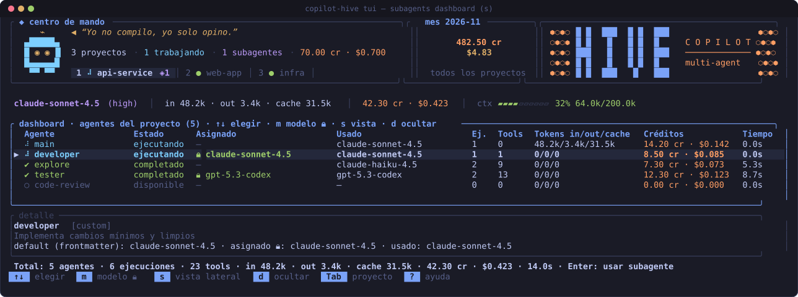

# Copilot Hive

Interfaz de terminal (TUI) en Rust para trabajar con **múltiples sesiones de GitHub Copilot CLI en paralelo** y supervisar en tiempo real sus agentes, subagentes, permisos y consumo de AI Credits.

Se conecta a Copilot mediante **ACP** ([Agent Client Protocol](https://docs.github.com/en/copilot/reference/copilot-cli-reference/acp-server), `copilot --acp --stdio`) para el control interactivo y lee `~/.copilot/session-state/<sessionId>/events.jsonl` para reconstruir el árbol de subagentes y métricas de uso.


## Características principales

- **Multiproyecto en pestañas:** abre varios repositorios a la vez (desde configuración o con el explorador `o`), cada uno con su propia sesión ACP, borrador independiente e indicador de estado.
- **Dashboard en tiempo real:** panel lateral (`d`) y vista completa (`s`) con agentes activos, histórico agrupado por tipo, barras de gasto, modelos asignados/usados y estado de tool calls.
- **Control de permisos y `/fleet`:** aprueba o rechaza peticiones (`y`/`n`/`a`), salta al siguiente proyecto bloqueado con `!`, activa *allow all* (`A`) o lanza tareas paralelas con `/fleet` (`f`).
- **Consumo y presupuesto:** seguimiento en vivo de AI Credits (y estimación en USD) por agente, por sesión y acumulado mensual de todos los proyectos en el header.
- **Prompts reutilizables (`p` / `Ctrl+S`):** biblioteca local compartida entre proyectos (`~/.config/copilot-hive/prompts.toml`).
- **Gestión de modelos, subagentes y MCP:** cambia modelo (`m`) y *reasoning effort* (`e`), fija modelos obligatorios por subagente (`🔒`), activa/desactiva servidores MCP por proyecto (`M`) y reanuda sesiones anteriores (`H`).
- **Ratón, temas e idioma:** foco y scroll independiente por panel (teclado `]`/`[` o ratón), tema oscuro/claro e idioma español/English (`S`).



## Requisitos

- **Rust** estable (edición 2024).
- **GitHub Copilot CLI** (`copilot`) instalado y autenticado en tu `PATH` con soporte ACP (`copilot --acp --stdio`).
- Terminal con soporte TrueColor (mínimo `60×20`; el panel lateral aparece a partir de `100` columnas).

## Instalación y uso

```bash
git clone https://github.com/EstebanSalmeron/CopilotHive.git
cd CopilotHive
cargo install --path .
```

O ejecutarlo directamente sin instalar:

```bash
cargo run --release -- tui
```

### Configuración de proyectos

Por defecto lee `~/.config/copilot-hive/projects.toml` (o `--config RUTA`):

```toml
[[projects]]
name = "api-service"
path = "/ruta/a/api-service"

[[projects]]
name = "web-app"
path = "/ruta/a/web-app"
```

Si no existe el archivo, se abre directamente sobre el directorio actual. Hay una plantilla en [`docs/config.example.toml`](docs/config.example.toml).

## Atajos rápidos

| Tecla | Acción |
|-------|--------|
| `Tab` / `Alt+1..9` | Cambiar de proyecto |
| `Enter` / `i` | Escribir prompt (`Alt+Enter` / `Ctrl+J` nueva línea, `Ctrl+S` guardar prompt, `Ctrl+V` pegar imagen en macOS) |
| `f` | Abrir prompt con `/fleet ` |
| `p` | Prompts guardados localmente |
| `d` / `s` | Mostrar/ocultar sidebar / vista completa de subagentes |
| `]` / `[` | Cambiar foco entre paneles (o click/rueda del ratón) |
| `y` / `n` / `a` | Aprobar / rechazar / aprobar siempre un permiso (`!` salta al siguiente pendiente) |
| `m` / `e` | Cambiar modelo / *reasoning effort* |
| `H` / `o` | Historial de sesiones / abrir nueva carpeta |
| `M` / `S` / `A` | Servidores MCP / ajustes (tema e idioma) / *allow all* |
| `?` / `q` | Ayuda / salir |

Referencia completa en [`docs/tui-keys.md`](docs/tui-keys.md).

## Arquitectura y desarrollo

- `src/acp/`: cliente JSON-RPC sobre NDJSON para `copilot --acp --stdio`.
- `src/events.rs` y `src/history.rs`: lectura incremental de `events.jsonl` para subagentes, historial y consumo mensual.
- `src/tui/`: interfaz con `ratatui` (pestañas, markdown, dashboard, modales, prompts locales, MCP y ajustes).

Verificación local:

```bash
cargo fmt --check
cargo clippy -- -D warnings
cargo test
```
